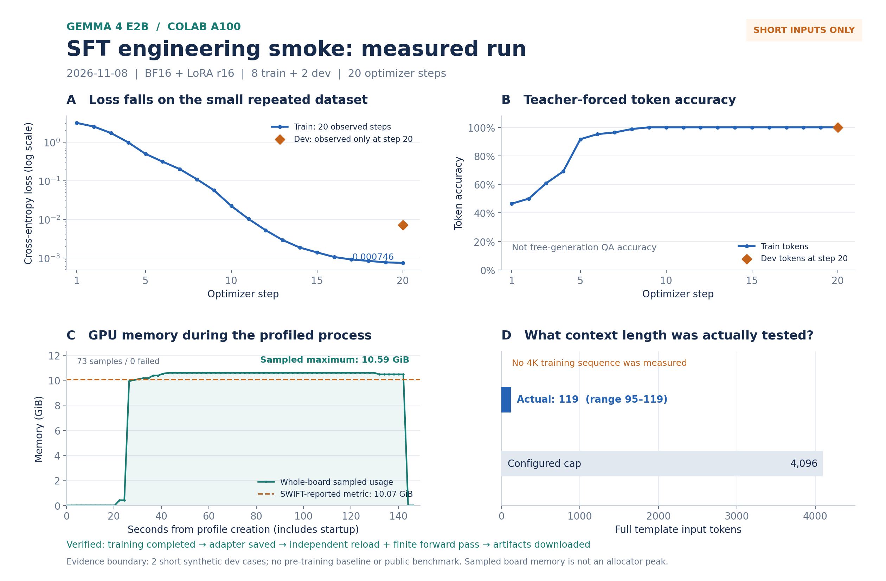

# Colab A100：Gemma 4 E2B SFT 工程试跑

2026-11-08 在 Colab **A100-SXM4 40GB** 上真实完成 Gemma 4 E2B Base 的
**BF16 + LoRA、20 optimizer steps**，保存 adapter、重载并验证前向计算有限值。
完整产物已下载、核验 SHA-256；本次 GPU 会话已停止，原有两个 CPU 会话未操作。

这是 10 条经用户审阅批准的原创虚构日志问答试跑，验证训练链路。
**不是正式长文 SFT，也没有测得 CPT 收益或公开基准提升。**

## 可视化记录

[打开可离线查看的可视化报告](report.html) · [矢量图 SVG](figures/sft_overview.svg) ·
[曲线数据与来源校验](visualization_manifest.json)

图中 dev 只显示实际第 20 步的单点；没有训练前基线或虚构的 dev 曲线。
重建命令：在仓库根目录运行 `python experiments/analysis/plot_training_run.py`。
正式长文研究的下一阶段见[实验方案](../long_context_design_20261108/README.md)。

## 实测结果

| 项目 | 结果 |
|---|---|
| 模型 | `google/gemma-4-E2B` Base，revision `433813a669639fd7eaa83155828e9000ed357d53` |
| 训练方式 | BF16 + LoRA，rank 16 / alpha 32，batch 1 / 梯度累积 8 |
| 数据 | 8 train + 2 dev，5 中文 + 5 英文；本次内部使用获人工批准 |
| 实际模板输入长度 | 95–119 token；4096 只是配置上限 |
| 模板检查 | 10/10 成功、0 丢弃；system/user 被 mask，仅助手答案及结束符参与 loss |
| 参数 | 约 2633 万可训练参数，占约 0.5133% |
| 步数 | 20/20；小数据重复 20 epochs |
| Trainer 训练时间 | 97.3171 秒；包含启动检查等的 profile 窗口 146.1189 秒 |
| 首 / 末训练步 loss | 3.145531 → 0.000746；不是训练前后独立评测 |
| Dev loss | 0.007150，仅 2 条相似的短合成样本 |
| Dev token accuracy | 1.0，teacher-forced token 指标，不是自由生成问答准确率 |
| SWIFT 日志显存值 | 10.0723 GiB，单独保留其原指标名称 |
| 整卡采样最大占用 | 10844 MiB（约 10.59 GiB）；73 次采样，0 次采样失败 |
| 保存与重载 | `checkpoint-20`，独立重载 adapter 成功，前向 logits 有限 |
| Adapter 文件 | 105415064 bytes，约 100.53 MiB |

整卡离散采样会漏掉采样间隔内的峰值，不能替代 Torch allocator 峰值。
短序列实测不能用于推断 4K / 8K 训练显存，也未验证 8GB 消费级卡上的量化部署。
2 条 dev 和 20 次重复训练不足以建立泛化结论。

## 可复现配置与证据

- [聚合结果与完整证据哈希](summary.json)
- [Colab 打包、环境准备、训练与回收说明](../../colab/README.md)
- [实际训练配置](../../ms_swift/configs/gemma4_e2b_sft_lora_4k_smoke.json)
- [完整人工审核包](../../ms_swift/.cache/colab_sft_review_20261108_v1/index.html)
- [用户批准记录](../../ms_swift/.cache/colab_sft_review_20261108_v1/human_approval_receipt.json)
- [本地产物 ZIP](../../ms_swift/.cache/colab_20261108/artifacts_v1.zip)
- [本地 checkpoint 目录中的 adapter](../../ms_swift/.cache/colab_20261108/artifacts_v1/experiments/ms_swift/.cache/colab/training/plan/checkpoints/v0-20261108-101259/checkpoint-20/adapter_model.safetensors)

安装了官方 [colab-operator skill](https://github.com/googlecolab/google-colab-cli/tree/main/skills/colab-operator)，
使用本机已有 CLI 0.7.5 与现有 OAuth 登录。官方仍声明 Linux/macOS 支持；本轮原生 Windows 的
会话、传输与执行实际成功，但出现两次临时 WebSocket 连接断开，重连或读取日志后继续，
没有重复提交训练。代码放在 `experiments/colab/`，没有向 backend 环境安装 GPU 依赖。

Colab 的 Python 3.12 独立环境通过 `pip check`、原生 BF16 小运算、锁定的 6 个模型文件大小与
SHA-256 校验。MS-SWIFT 4.6.0 使用固定上游 commit
`ad818a2cdfafaf4305ac40c4acd892a211978bc2`；Torch 2.8.0+cu128、Transformers 5.12.1。
完整 `pip freeze`、实际模板编码审计、输入与人工审核凭据、训练日志、显存采样、
adapter / optimizer / trainer state 和重载结果均在本地 ZIP 中。CPU 传输边界测试 7/7 通过。

ZIP SHA-256：`99111455f755d12cf9a8351e2bb3bbc9002e75e668b4656bf9873f03a2bdac76`。

Adapter SHA-256：`824fca2178430f1abcee9f32b127f892866ebcc51c89bfedf666287f33bea950`。

正文、凭据、环境、会话状态和检查点保持 Git 忽略，远端 clone 不自带这些本地产物。
云端计划保留原绝对路径作为历史证据；不能改写后拿到本地执行。
本产物是 LoRA adapter，需要对应基座；未合并、未量化、未上传 Hugging Face。

## 后续研究实验

接下来需准备规模更大、经过审核的真实长文 SFT 数据，固定训练前后统一的评测协议，
再进行公开基准与长距离依赖任务的对照。原有 31 篇长文审核包仍是 pending，
本次 10 条试跑的批准不授予其他语料训练资格。正式 CPT 和 CPT→SFT 对照仍未执行。
